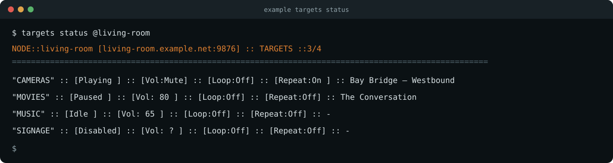

# mpv-targets

**Named mpv targets for local and remote playback.**

`mpv-targets` runs and supervises multiple mpv players as stable, named
destinations. Send a file, URL, stream, or M3U playlist to a target such as
`cameras`, `movies`, or `music`, then control it locally or across the
network.

mpv remains the player. This project supplies target lifecycle, recovery,
observable playback state, and a common control protocol. It is not a media
library, downloader, CMS, or NVR.



The project provides:

- `mpv-targetsd` — target supervision, mpv IPC, state, and the WSS service;
- `targets` — the local and remote operator CLI;
- `deploy-targets` — answer-file deployment for Linux nodes;
- `mpv_targets` — the shared Rust client and protocol library.

## Targets, playlists, and channels

A **target** is one configured mpv destination. Its name identifies its
configuration, process, IPC socket, and client operations. Each target keeps
ordinary native mpv settings in:

```text
~/.config/mpv-targets/targets/<target>/mpv.conf
```

The **live playlist** is mpv's current queue. Commands such as `loadfile`,
`append`, `playlist`, `next`, and `shuffle` operate on it.

A **channel** is a persistent M3U selection loaded when a target starts.
User-managed `.m3u` and `.m3u8` files normally live in the node's shared
`~/.config/mpv-targets/channels/` directory. A target may instead use an
absolute playlist path or URL.

The service consumes playlists but does not discover or organize media.

## Lifecycle

Enabled or disabled is the only persistent lifecycle choice. Stopped is
session state; online describes the daemon's current IPC connection to mpv.

| State or action | Behavior |
| --- | --- |
| Enabled | Runs normally. At daemon startup, the target is attached to an existing configured mpv process or launched. |
| Disabled | Persistently off. Disabling a running target also stops it. |
| `stop` | Stops an enabled target for the current daemon session without disabling it. |
| `start` | Starts an enabled, intentionally stopped target. |
| `restart` | Stops and relaunches an enabled target. A disabled target remains off. |
| Online | The daemon has a live IPC connection to the target's mpv process. |
| Offline | The target is expected to run, but its mpv connection is unavailable. |

An unexpected mpv exit triggers recovery with capped retry backoff. An
intentional stop does not. A daemon restart reattaches to healthy configured
mpv processes instead of creating duplicates.

Status resolves target state in this order:

```text
disabled → stopped → offline → idle → paused → playing
```

## Quick start

Requirements are Rust and mpv. The supplied service deployment targets Linux
systemd user services.

```bash
cargo build --release --bins

install -Dm755 target/release/mpv-targetsd ~/.local/bin/mpv-targetsd
install -Dm755 target/release/targets ~/.local/bin/targets
install -Dm755 target/release/deploy-targets ~/.local/bin/deploy-targets
```

Copy the documented answer file, set the node address and initial targets, then
deploy:

```bash
cp examples/setup.toml setup.toml
$EDITOR setup.toml
deploy-targets setup.toml
targets status
```

Use the node's LAN address when other machines will connect, or `127.0.0.1`
for local-only operation. The `hyprland` host profile adds graphical-session
readiness for a provisioned Hyprland node.

Deployment refuses to replace an existing configuration. Intentional
redeployment uses `deploy-targets --overwrite setup.toml` and requires
confirmation.

The daemon can also run directly under an application or another supervisor:

```bash
mpv-targetsd --config ~/.config/mpv-targets/mpv-targets.toml
```

Visible mpv windows require the graphical session's environment.

## Using `targets`

### Status and lifecycle

```bash
targets status
targets status movies
targets status --json

targets stop movies
targets start movies
targets restart cameras movies
targets disable signage
targets enable signage --start
targets restart all
```

Commands accepting multiple targets process them in written order. Supported
node-wide commands accept `all`.

### Target management

```bash
# New targets begin disabled and stopped.
targets add preview

# Copy mpv.conf, scripts, and the selected channel reference.
targets add booth --from cameras --start

# Rename requires a stopped target and confirmation.
targets stop preview
targets rename preview confidence

# Removal also requires confirmation.
targets remove confidence
```

`--from` does not copy lifecycle state or channel files. For new
hardware-specific settings, add the target disabled, edit its local
`mpv.conf`, then enable and start it.

### Playback

```bash
targets loadfile movies 'https://media.example/movie.mkv'
targets append movies '/srv/media/trailer.mkv'
targets play movies
targets pause movies
targets next movies
targets mute movies
targets fullscreen movies
targets loop movies       # current item
targets repeat movies     # complete playlist
```

Paths and URLs are passed literally to mpv. A path sent to a remote target must
exist on that remote host; `loadfile` does not transfer files.

### Live playlist

```console
$ targets playlist music
"MUSIC" :: [Current Playlist]
    0 First track.flac
>   1 Second track.flac
    2 https://radio.example/live

$ targets playlist music 2
"MUSIC"          :: [Playlist:2] :: [OK]
```

Playlist indexes match mpv and begin at zero.

### Channels

Add M3U files to `~/.config/mpv-targets/channels/`, then list and select
them:

```console
$ targets show-channels
:: [Channels] ::

1. cameras.m3u8
2. local-music.m3u
3. signage.m3u8

$ targets set-channel cameras 1 --restart
"CAMERAS"        :: [cameras.m3u8] :: [SET]
```

A catalog number, filename, absolute M3U path, or URL may be selected:

```bash
targets set-channel music local-music.m3u --restart
targets set-channel signage /srv/channels/lobby.m3u8
targets clear-channel signage --restart
```

## Remote nodes

Connect directly:

```bash
targets --url wss://192.168.1.50:9876 status
```

For named nodes, create `~/.config/mpv-targets/nodes.toml`:

```toml
[[nodes]]
id = "living-room"
url = "wss://living-room.example.net:9876"

[[nodes]]
id = "studio"
url = "wss://10.0.0.40:9876"
```

Then place the `@node` selector immediately after the command:

```bash
targets status @living-room
targets restart @living-room cameras music
targets loadfile @studio preview 'https://media.example/live.m3u8'
```

The node book contains connection addresses only; it does not deploy or
configure targets.

## Transport and security

The daemon serves JSON over TLS WebSockets (`wss://`). Native clients accept
generated or supplied certificates without certificate or hostname
validation, allowing self-signed private-LAN deployments.

TLS encrypts the connection but does not authenticate clients or authorize
commands. Do not expose `mpv-targetsd` directly to the public internet.
Browsers retain their own certificate-trust requirements.

## Development

```bash
cargo test --workspace
cargo clippy --workspace --all-targets -- -D warnings
cargo fmt --all --check
```
